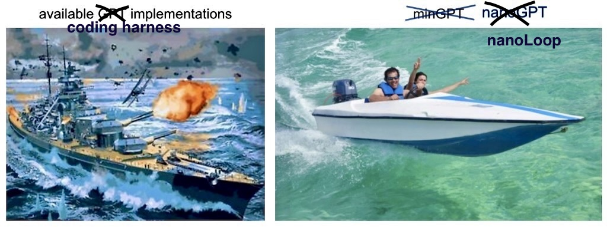

# NanoLoop

A most-simple implementation of the Claude Code architecture, that is actually effective. 
Inspired by Karpathy's [nanoGPT](https://github.com/karpathy/nanoGPT).

Most harnesses claiming to achieve the above fall short for one of two reasons:
1) There is far more code, and are far more features than needed for effective performance (more on the definition of "effective" below).
2) They are overly simplistic and claim to demonstrate the Claude Code architecture pattern, but they are never benchmarked against anything.

NanoLoop solves these issues. It is hand-coded and demonstrates the minimum functionality required to make an effective coding agent.

*What makes a harness 'effective'? I measure efficacy by performance on SimpleBench, a benchmark I've written and included in this repo. That's described further in 'Experiment'*.

## Experiment

NanoLoop is a harness that lives in nano_loop/. It runs a Claude-Code style query loop, tool registry and processor, and Docker sandboxing for file reading, writing, and python execution.

Control is a harness that lives in control/. It simply performs an LLM call with an equivelent system prompt to NanoLoop.

SimpleBench is a benchmark of 102 questions, living in simple_bench. It is comprised of all publically available LeetCode Medium and Hard problems from the last 6 months that follow standard formatting. It uses threading to simultaneously allow NanoLoop and Control to answer the benchmark's question catologue. It then runs a grading process in Docker.

I ran NanoLoop and Control on SimpleBench, across 2 SLMs (ibm-granite/granite-4.2-8b, nvidia/nemotron-3.5-lightning) and 1 LLM (moonshotai/kimi-k3, reasoning off).

## Results

| Model Name | Harness | Model Parameters | Medium | Hard | Total | Total Code Failures | Run Cost |
|---|---|---|---|---|---|---|---|
| moonshotai/kimi-k3 | NanoLoop | 2.8T | 60/66 | 30/36 | 90/102 | 1 | $23.82 |
| moonshotai/kimi-k3 | Control | 2.8T | 47/66 | 16/36 | 63/102 | 3 | $3.15 |
| ibm-granite/granite-4.2-8b | NanoLoop | 8B (dense) | 45/66 | 13/36 | 58/102 | 3 | $1.40 |
| ibm-granite/granite-4.2-8b | Control | 8B (dense) | 39/66 | 11/36 | 50/102 | 11 | $0.16 |
| nvidia/nemotron-3.5-lightning | NanoLoop | 30B total / 3B active (MoE) | 43/66 | 18/36 | 61/102 | 0 | $1.12 |
| nvidia/nemotron-3.5-lightning | Control | 30B total / 3B active (MoE) | 29/66 | 9/36 | 38/102 | 7 | $0.15 |

In short:
* NanoLoop performs significantly better than Control on every model: 8% (Granite), 23% (Nemotron), 26% (Kimi)
* NanoLoop produces significantly fewer code failures: 3 v. 11 (Granite), 0 v. 7 (Nemotron), 1 v. 3 (Kimi)
* NanoLoop achieves a max of 88% correctness (Kimi)
* NanoLoop with Granite (8b params) is only 3% worse than the Control with Kimi (2.8 trillion paramts) at solving Medium problems
* NanoLoop is able to 2x accuracy on Hard problems for a 3B active param model (Nemotron)